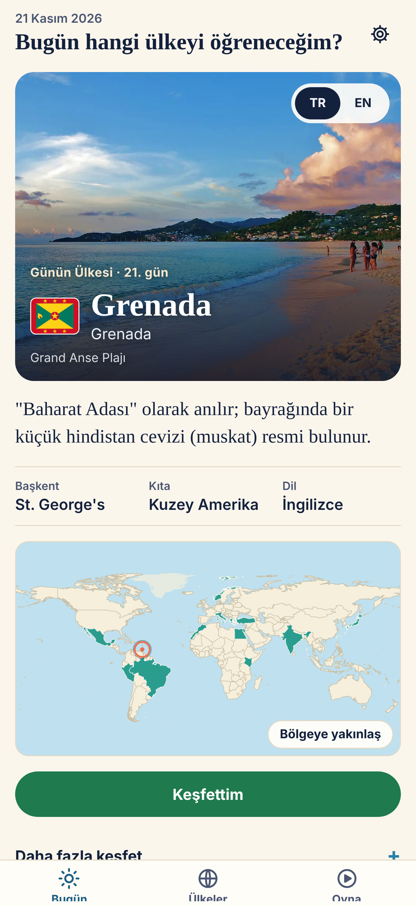
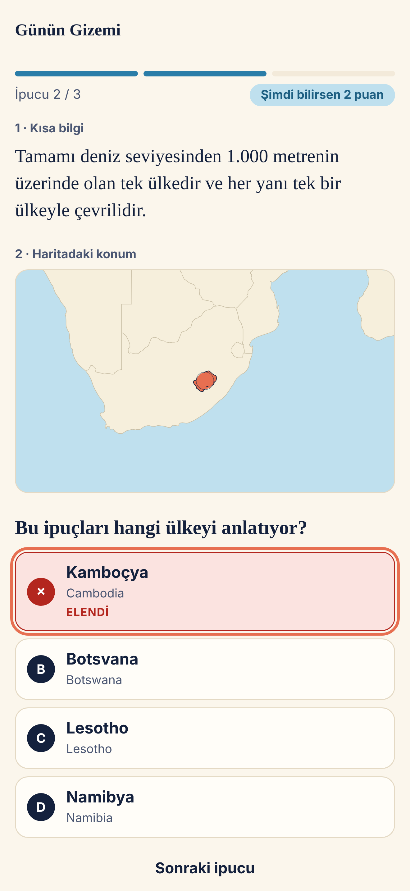
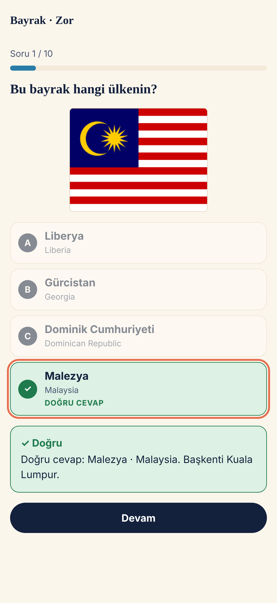
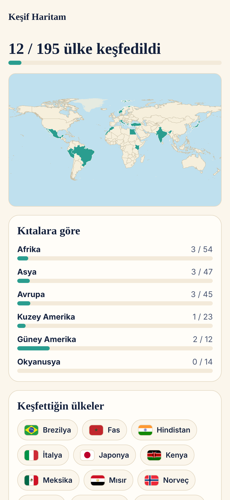

# Dünya Cepte · Pocket World

[](https://github.com/beza0/pocketWorld/actions/workflows/ci.yml)
[](https://dunya-cepte.vercel.app)

**Her gün bir ülke.** *“Bugün hangi ülkeyi öğreneceğim?”* sorusuyla açılan; iOS, Android ve web'de çalışan
bir coğrafya öğrenme ve oyun uygulaması. Bir ülkeyi yaklaşık bir dakikada tanırsın, istersen ayrıntılara
inersin, öğrendiklerini oyunlarla pekiştirirsin. Türkçe arayüzde **Dünya Cepte**, İngilizce arayüzde
**Pocket World** adını taşır.

*A country a day: a geography learning and quiz app for iOS, Android and the web, in Turkish and English.*

**Canlı web sürümü:** https://dunya-cepte.vercel.app

| Bugün | Günün Gizemi | Bayrak oyunu | Keşif Haritam |
| :---: | :---: | :---: | :---: |
|  |  |  |  |

## Özellikler

**Bugün**
- **Günün Ülkesi:** gerçek bir fotoğraf, bayrak, haritadaki konum, başkent, kıta, diller ve akılda
  kalıcı kısa bir bilgi. “Daha fazla keşfet” altında kültür, yemek ve görülecek yer. “Keşfettim” ile
  ülke kişisel haritada renklenir. Kart, arayüz dilini değiştirmeden TR/EN okunabilir.
- **Bugünün 3 Sorusu:** bayrak, harita ve kısa bilgi; her cevaptan sonra kısa bir açıklama.
- **Günün Gizemi:** üç ipucu (kısa bilgi → harita → bayrak), dört sabit seçenek; 3 / 2 / 1 / 0 puan.
  İlk sonuç kaydedilir; uygulamayı yeniden açmak ya da dili değiştirmek sonucu sıfırlamaz.
- **Önceki Günler:** daha önce yayımlanan ülke kartları.

**Ülkeler**
- 195 ülkenin tamamı: 193 BM üyesi, Filistin ve Vatikan.
- Türkçe ve İngilizce adla, alternatif yazımlarla arama (`Türkiye`, `Turkiye`, `Turkey` aynı ülkeyi bulur);
  kıtaya göre filtre.
- **Keşif Haritam:** toplam ve kıta bazında ilerleme (`12 / 195 ülke keşfedildi`).
- Her ülkenin paylaşılabilir bir adresi var: `/country/<ISO kodu>`, ör.
  [dunya-cepte.vercel.app/country/jp](https://dunya-cepte.vercel.app/country/jp).

**Oyna**
- Beş mod: Bayrak, Harita, Kısa Bilgi, Fotoğraf, Karışık. İki seviye: Kolay ve Zor. Her tur 10 soru.
- Zor seviyede komşu ülkeler ve birbirine benzeyen bayraklar; Kolay seviyede belirgin seçenekler.
- “Keşfettiklerim” havuzuyla yalnızca kendi haritandaki ülkelerden tekrar.
- Yanlış bilinen ülkeler sonraki turlarda başka bir soru türüyle daha sık gelir (tur başına en fazla 3).

**Her yerde**
- Günlük içerik **Türkiye saatiyle 00.00'da** değişir; her saat diliminde herkes aynı ülkeyi görür.
- Çevrimdışı çalışır: mobilde temel paket uygulamayla gelir; web'de Ayarlar → “Çevrimdışı kullanıma hazırla”.
- Kayıt zorunlu değil, reklam yok. İsteğe bağlı hesapla ilerleme cihazlar arasında yedeklenir.
- Günlük hatırlatma (varsayılan kapalı, önerilen saat 09.00), iOS ve Android'de yerel bildirimle.

## Teknoloji

| Alan | Kullanılan |
| --- | --- |
| Uygulama | Expo SDK 58, React Native, TypeScript, Expo Router |
| Harita | Natural Earth sınırlarından üretilmiş, üzerinde ad yazmayan SVG |
| Depolama | AsyncStorage (cihazda kalıcı ilerleme) |
| Hesap ve eşitleme | Supabase Auth (e-posta kodu) + Postgres, satır düzeyi güvenlik |
| Web yayını | Vercel; service worker ile doğrulanmış çevrimdışı paket |
| Mobil derleme | EAS Build / EAS Submit |
| Test | Vitest (birim), Playwright (web uçtan uca) |

## Başlarken

Gereksinimler: Node.js 22 veya üstü, npm.

```bash
git clone https://github.com/beza0/pocketWorld.git
cd pocketWorld
npm install
npm run web
```

| Komut | Ne yapar |
| --- | --- |
| `npm run web` | Web'de geliştirme sunucusu |
| `npm run ios` / `npm run android` | iOS simülatöründe / Android emülatöründe çalıştırır |
| `npm run build:web` | Web yayın derlemesi ve çevrimdışı paket listesi → `dist/` |
| `npm run serve:web` | `dist/` klasörünü http://localhost:8080 adresinde sunar |
| `npm run typecheck` · `npm run lint` · `npm test` | Tip denetimi, lint, birim testleri |
| `npm run e2e:web` | Uçtan uca web testleri (önce `build:web` ve `serve:web`) |
| `npm run content:validate` | 195 ülkelik içeriği doğrular |
| `npm run content:build` · `npm run content:photos` | İçerik paketini üretir · eksik fotoğrafları indirir |
| `npm run store:screenshots` · `npm run brand:icons` | Mağaza ekran görüntülerini ve ikonları üretir |

Günlük hatırlatma yerel modül kullandığı için iOS ve Android'de Expo Go yerine bir geliştirme derlemesinde
denenmelidir: `npx expo run:ios`, `npx expo run:android` ya da `eas build --profile development`.

### Ortam değişkenleri

Hepsi isteğe bağlıdır. Tanımlı değilse uygulama misafir modunda bütün özellikleriyle çalışır; yalnızca
hesap ekranı “yapılandırılmamış” mesajı gösterir. `.env.example` dosyasını `.env.local` olarak kopyalayıp
doldurun.

| Değişken | Açıklama |
| --- | --- |
| `EXPO_PUBLIC_SUPABASE_URL` | Supabase projesinin adresi |
| `EXPO_PUBLIC_SUPABASE_ANON_KEY` | Supabase anon (publishable) anahtarı; istemcide bulunması güvenlidir |

Service-role anahtarı istemciye ya da repoya konmaz. Supabase kurulumu:

1. `supabase/migrations/` altındaki iki dosyayı uygulayın (`supabase db push` ya da SQL editörü).
2. Authentication → Providers → Email'de “Email OTP”yi açın; e-posta şablonunda `{{ .Token }}` bulunsun.
3. Adres ve anon anahtarı `.env.local` dosyasına (mobil derlemeler için EAS ortam değişkenlerine) yazın.

## Proje yapısı

```
src/app/              Ekranlar (Expo Router)
  (tabs)/             Alt menü: Bugün (index), Ülkeler (countries), Oyna (play)
  country/[id].tsx    Ülke kartı, paylaşılabilir adres
  quiz.tsx            Bugünün 3 Sorusu
  mystery.tsx         Günün Gizemi
  round.tsx           Serbest oyun turu
  atlas.tsx           Keşif Haritam
  previous.tsx        Önceki Günler
  settings.tsx        Dil, hesap, hatırlatma, çevrimdışı paket
  account.tsx         Giriş, eşitleme, hesap silme
  privacy.tsx         Gizlilik politikası (web'de /privacy)
src/core/             Platformdan bağımsız mantık: takvim, sorular, gizem, arama, ilerleme, eşitleme
src/components/       Ülke kartı, harita, bayrak, fotoğraf, soru bileşenleri, arayüz parçaları
src/platform/         Platform adaptörleri: depolama, bildirim, çevrimdışı (mobil ve web ayrı)
src/services/         Supabase istemcisi
src/data/generated/   İçerik hattının çıktıları (elle düzenlenmez)
content/              Editoryal metinler, düzeltmeler, takvim, fotoğraf kaynak kayıtları
scripts/              İçerik hattı, web çevrimdışı paketi, testler, ikon ve ekran görüntüsü üreticileri
store/                Mağaza metinleri, ekran görüntüleri, yayın rehberi
supabase/migrations/  Veritabanı şeması, güvenlik politikaları, hesap silme
public/sw.js          Web service worker
```

## İçerik

Ülke verileri sürümlü ve yeniden üretilebilir bir hattan gelir; ayrıntılar
[`content/README.md`](content/README.md) dosyasında.

- **195 ülke**, her biri Türkçe ve İngilizce: kısa bilgi, kültür, yemek, görülecek yer, başkent, diller.
- **195 fotoğraf**, Wikimedia Commons'tan; yazar, lisans ve kaynak `content/photos.lock.json` içinde
  ve ülke kartının altında görünür.
- **Günlük takvim:** her 195 günlük döngüde her ülke Günün Ülkesi'nde de Günün Gizemi'nde de tam bir kez
  çıkar; aynı gün iki seri asla aynı ülkeyi göstermez. Yayımlanmış günler kilitlidir, sonradan değişemez.
- **Otomatik doğrulama** (`npm run content:validate`): 195 ülkenin eksiksizliği, iki dil, ipucu
  metinlerinde cevabın (ülke adı, başkent) geçmemesi, arama, harita geometrisi, takvim, her ülke ve her
  soru türü için geçerli dört şıklı sorular, fotoğraf bütünlüğü ve lisansları.

| Ölçü | Değer |
| --- | --- |
| Temel içerik paketi | 28,2 MB (fotoğraflar 26,7 MB · bayraklar 0,6 MB · veri ve harita 0,9 MB) |
| Web çevrimdışı paketi (uygulama dahil) | yaklaşık 30 MB |

## Yayın

- **Web:** varsayılan dala yapılan her push Vercel'de otomatik yayınlanır →
  https://dunya-cepte.vercel.app. `vercel.json`, `netlify.toml` ve `public/_redirects` hazırdır.
- **App Store ve Google Play:** EAS ile derlenir ve gönderilir:

  ```bash
  npx eas-cli@latest build --platform all --profile production
  npx eas-cli@latest submit --platform all --profile production
  ```

  Adım adım rehber, mağaza metinleri (TR/EN), ekran görüntüleri ve gizlilik formlarının cevapları:
  [`store/README.md`](store/README.md).
- **Gizlilik politikası:** https://dunya-cepte.vercel.app/privacy · Hesap silme uygulamada Hesap ekranında.
- **GitHub Actions:** `CI` her push'ta tip denetimi, lint, birim testleri, içerik doğrulama ve web
  derlemesi yapar. `EAS build` iş akışı elle tetiklenir (`EXPO_TOKEN` gizli değişkeni gerekir).

## Test ve doğrulama

| Kontrol | Kapsam |
| --- | --- |
| Birim testleri (30) | Türkiye saatiyle gün değişimi, takvim, gizem puanı, arama, soru üretimi, ilerleme birleştirme ve yinelenmeyen eşitleme |
| Web uçtan uca (17 senaryo) | İlk açılış, ülke kartı, 3 soru, gizem ve kalıcılığı, arama, keşif haritası, serbest oyun, farklı saat dilimleri, internet kapalıyken yeniden açılış, klavye ile kullanım |
| İçerik doğrulama | 195 ülke, iki dil, 9.360 üretilmiş soru, takvim kilidi, fotoğraf lisansları |
| Platformlar | Web (Chromium, mobil ve geniş ekran) uçtan uca doğrulandı. iOS ve Android için JS paketleri ve yerel proje üretimi hatasız; cihaz/simülatör testi EAS derlemesiyle yapılacak. |

## Kaynaklar ve atıflar

| İçerik | Kaynak | Lisans |
| --- | --- | --- |
| Ülke listesi, kodlar, başkentler, diller, komşuluklar | [world-countries](https://github.com/mledoze/countries) | ODbL 1.0 |
| Harita sınırları | [Natural Earth](https://www.naturalearthdata.com/) ([world-atlas](https://github.com/topojson/world-atlas)) | Kamu malı |
| Bayraklar | [flag-icons](https://github.com/lipis/flag-icons) | MIT |
| Fotoğraflar | [Wikimedia Commons](https://commons.wikimedia.org/) | 144 CC BY-SA · 34 CC BY · 8 CC0 · 9 kamu malı |
| Kısa bilgi, kültür, yemek ve yer metinleri | Bu proje için yazıldı (TR/EN) | Dünya Cepte |

Fotoğrafların küçültülmüş ve kırpılmış hâlleri, CC BY-SA dosyalar için aynı lisansla dağıtılır.
